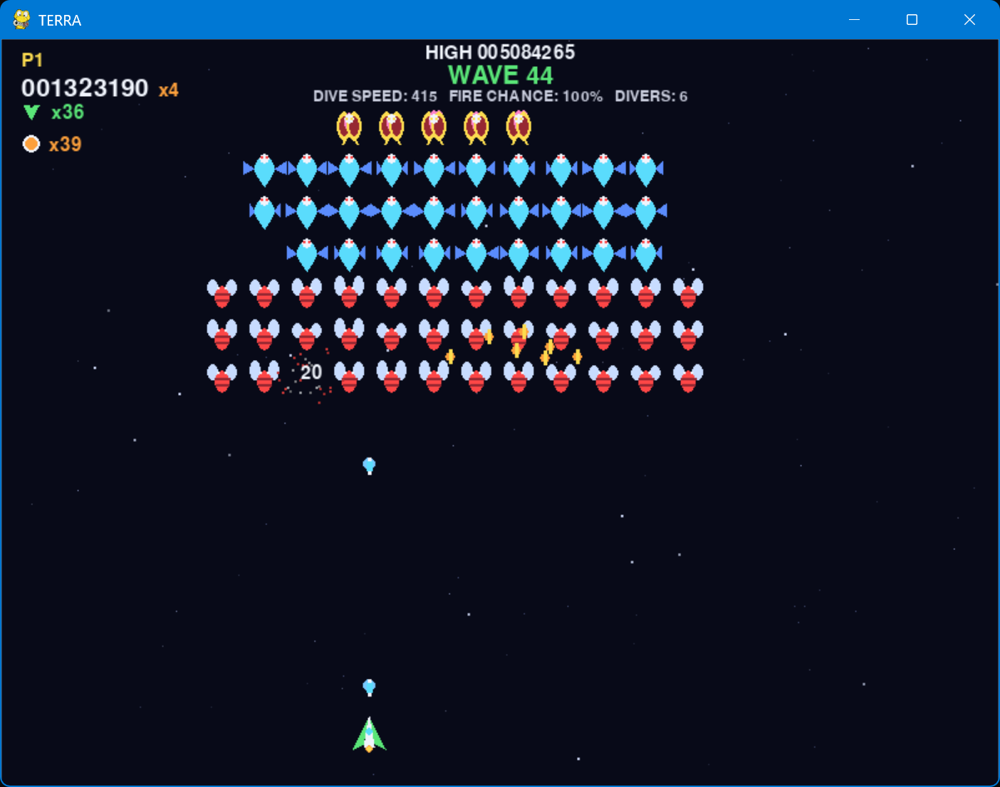

<div align="center">

# 🚀 TERRA

[](https://www.python.org/)
[](https://www.pygame.org/)
[](LICENSE)

### Defend the Earth from the invading forces of Kryova.

A colorful, arcade-style **TERRA** clone built with [`pygame`](https://www.pygame.org).
**Zero external assets** — every sprite is drawn with pygame primitives and every
sound effect is synthesized at runtime with numpy, so the entire game ships in a
single folder.

<p align="middle">
  
</p>

</div>

## 📦 Install

```bash
pip install -r requirements.txt
```

## 🎮 Run

```bash
python main.py
```

You can also resize the window manually, or fill the monitor entirely by running

```bash
python main.py --fullscreen
```

<details>
<summary>🧪 Headless self-test (CI / no window needed)</summary>

```bash
python main.py --selftest   # prints SELFTEST OK on success
```

</details>

## 🎯 Controls

| Action | Player 1 | Player 2 |
| :--- | :---: | :---: |
| Move left | `←` | `A` |
| Move right | `→` | `D` |
| Bomb | `↑` | `W` |
| Pause (either) | `P` | `P` |
| Menu / confirm | `Enter` | `Enter` |
| Quit | `Esc` | `Esc` |

## 💯 Scoring

| Enemy | Points |
| :--- | :---: |
| 🐝 Bee | 5 |
| 🛸 Hornet | 10 |
| 👾 Boss | 40 |

Points are multiplied by your current streak (×1–×100). A kill on a **diving**
enemy is worth double its base value.

## 🎁 Power-ups

| Pickup | Effect |
| :--- | :--- |
| ⚡ **Rapid Fire** | Faster fire rate for 8 s |
| ✦ **Triple Shot** | 3-way spread for 8 s |
| ◉ **Shield** | Absorbs one hit |
| 💣 **Bomb** | Stacks; press `↑` (P1) or `W` (P2) to fire a 30-shot fan across a 60° forward cone |
| ♥ **Extra Life** | +1 life |
